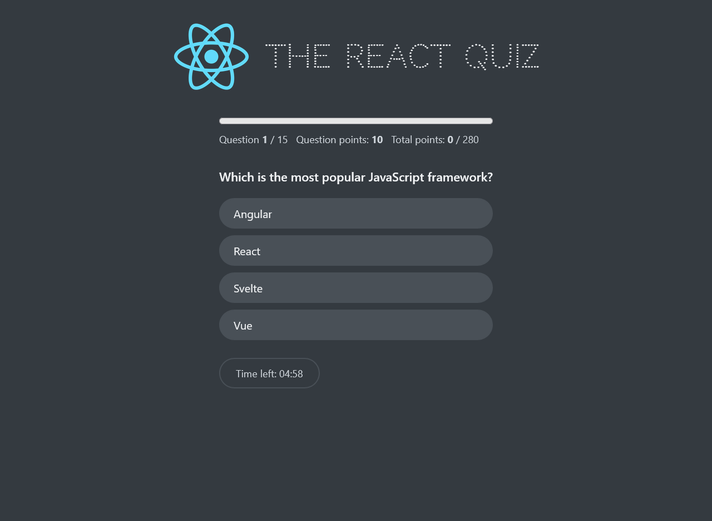

# The React Quiz

An interactive quiz app that tests your React knowledge. Answer 15 questions against a countdown timer, collect points, and try to beat your high score.

**[Live demo](https://the-react-quiz-app-blush.vercel.app/)**



## Features

- 15 multiple-choice questions on React fundamentals (components, props, state, effects, hooks).
- Each question is worth 10, 20, or 30 points depending on difficulty.
- Countdown timer (20 seconds per question); the quiz ends automatically when time runs out.
- Instant feedback: the correct answer turns green and wrong answers are marked after you pick.
- Progress bar with current question, question points, and running total.
- Final score with percentage, plus a high score that carries over between restarts in the same session.
- Loading and error states while the questions are fetched.

## Tech stack

- React 18 (Create React App)
- `useReducer` for all quiz state, `useEffect` for data fetching and the timer
- Plain CSS
- Deployed on Vercel

## How it works

The whole app is driven by one reducer in `App.js` with five statuses: `loading`, `error`, `ready`, `active`, and `finish`. Each status renders a different part of the UI.

- On first render, `useEffect` fetches `questions.json` from the `public/` folder, so no backend or server is needed.
- Answering a question updates the score and locks the options.
- The `Timer` component dispatches a `ticking` action every second and cleans up its interval on every re-render.
- Restarting resets the quiz but keeps the questions and the high score.

## Project structure

```
public/
  questions.json        # quiz data
src/
  App.js                # reducer, state, and app layout
  Components/
    Header.js
    Main.js
    Loader.js
    Error.js
    Start.js
    Question.js
    Progress.js
    Timer.js
    Finish.js
```

## Getting started

```bash
git clone https://github.com/Ahmed-Abdlhameed/The-React-Quiz-App.git
cd The-React-Quiz-App
npm install
npm start
```

The app runs at [http://localhost:3000](http://localhost:3000).

## Build

```bash
npm run build
```

## Adding your own questions

Edit `public/questions.json`. Each question follows this shape:

```json
{
  "question": "Which company invented React?",
  "options": ["Google", "Apple", "Netflix", "Facebook"],
  "correctOption": 3,
  "points": 10
}
```

`correctOption` is the zero-based index of the right answer in `options`.

## Author

Built by **Ahmed Abdelhameed**. Find me on [GitHub](https://github.com/Ahmed-Abdlhameed).
